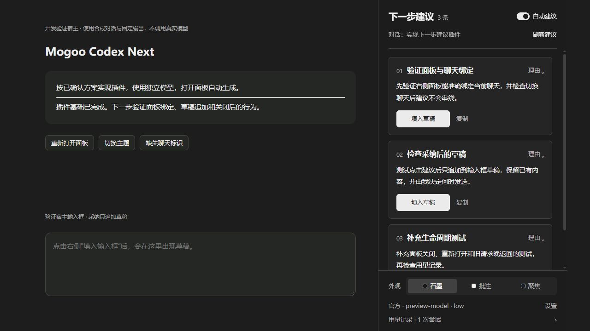
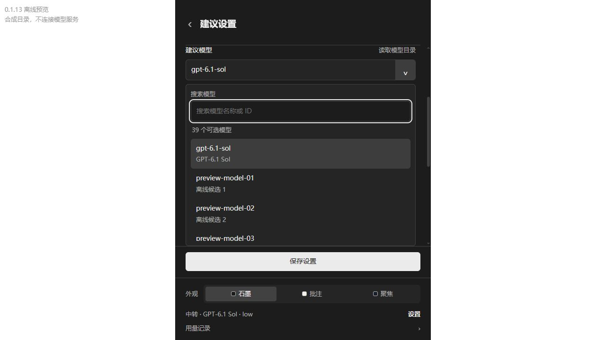

# Mogoo Codex Next

**English** | [简体中文](README.zh-CN.md)

---



*Offline development preview with sample conversation data. The panel currently uses Chinese labels.*

Mogoo Codex Next brings next-step suggestions into the right-hand panel of your current Codex chat. It reads the conversation context, proposes relevant follow-ups, and lets you append a suggestion to your draft or submit it immediately with Direct execution.

The plugin uses its own model settings. Open the panel to generate suggestions; close it to pause new requests. You decide what gets sent.

## Features

- **Suggestions for the current chat:** up to three follow-ups based on your goal and the latest completed reply, with expandable reasons.
- **Draft or direct execution:** append a suggestion for editing, or click Direct execution to submit the full suggestion to the current chat. Only an explicit click sends a message; repeated submissions from the same result are blocked. Copying remains available.
- **Independent model settings:** choose the provider, model, reasoning effort, and service tier separately from the chat's model. Defaults are `gpt-6.1-terra`, low reasoning effort, and Fast service.
- **Relay API connection:** calls the selected Responses API directly over HTTP, with an AI Code With preset and custom endpoints. Choose concise or standard suggestion wording.
- **Searchable model picker:** browse the full returned catalog, search names or IDs, use the keyboard, or enter an ID manually. Changes apply after saving.
- **Automatic and manual generation:** generate while the panel is open, refresh on demand, and reuse valid results for an unchanged conversation state.
- **Earlier first suggestion:** relay streaming can show the first complete suggestion after checking the current chat, while the rest continues. Draft insertion becomes available after full validation.
- **Adjustable wording:** short titles (up to 16 characters) and one-sentence reasons (up to 50 characters) are enabled by default. Set either option to Standard to keep the original length rules; editable instructions retain their full detail.
- **Instruction length target:** aim for 80 characters by default, or choose 0–2000 (0 disables the target). Key conditions take priority and complex instructions may exceed it; returned instructions are never cut to meet the target.
- **Three appearances:** Graphite, Paper, and Microglow, shared across suggestions, settings, usage, and update dialogs. The choice saves immediately without changing model settings or generating suggestions.
- **Responsive panel:** keeps the compact sidebar layout, expands the content area up to 960px in wider views, and respects host safe areas so fullscreen controls stay above the floating composer.
- **Usage records:** view the latest 20 attempts with reported tokens and expandable HTTP, verification, first-card and complete-result visibility timings. Unobserved stages remain unknown.

## Installation

Requires **Git**, **Python 3.10+** and a **Codex desktop app with MCP Apps and chat-panel support**. No separate Codex CLI installation is required. The plugin first discovers the desktop app's bundled runtime for read-only chat synchronization. Generation only uses the relay HTTP API. Development and native validation have focused on Windows; saving API keys directly currently requires Windows account encryption (DPAPI).

### Copy this prompt and send it to Codex

```text
Install the complete Mogoo Codex Next plugin from the GitHub repository https://github.com/MogooStudio/mogoo-codex-plugin.git, using its mogoo-codex-plugin marketplace and official Codex plugin entrypoints. Check Git, Python 3.10+ and the desktop app's bundled runtime; do not require a separate CLI installation. Explain any plugin refresh or restart needed before opening the current chat's Next Steps panel, and any optional Hook trust steps. Let me choose the model in panel settings, keep API keys out of chat, and do not send any draft messages.
```

### Command-line installation (optional)

The `codex` commands below can use the full path to the desktop app's bundled runtime or an existing command-line entrypoint. Installing the npm CLI package separately is unnecessary.

```sh
codex plugin marketplace add https://github.com/MogooStudio/mogoo-codex-plugin.git --ref main
codex plugin add mogoo-codex-next@mogoo-codex-plugin
```

This installs the complete plugin: the chat-panel MCP service, Codex skill, and optional Stop hook. Follow Codex's prompt to refresh plugins. Start a new chat or restart Codex to activate the plugin; finish active work before restarting.

Hooks must be reviewed and trusted through Codex's official interface. Installing or updating does not automatically trust them. The panel can also detect completed replies through read-only polling.

To install the [Git plugin](https://github.com/MogooStudio/mogoo-codex-git), select **Mogoo Codex Git** in **Mogoo Codex Plugin** or run `codex plugin add mogoo-codex-git@mogoo-codex-plugin`.

### Migrate from the old marketplace

After the new marketplace is published, existing `mogoo-next` users can close the Next Steps panel and run these commands once. Your settings, appearance, encrypted keys, and usage records stay in the plugin's data directory.

```sh
codex plugin remove mogoo-codex-next@mogoo-next
codex plugin marketplace remove mogoo-next
codex plugin marketplace add https://github.com/MogooStudio/mogoo-codex-plugin.git --ref main
codex plugin add mogoo-codex-next@mogoo-codex-plugin
```

### Updates

When the panel opens, the plugin checks public repository tags automatically at most once every six hours. Failed checks wait at least one hour without error popups or automatic retry loops. Only the tag list is read; no chat, settings, or other data is uploaded. Disable **检查更新** (Check for updates) in settings, or use **立即检查** (Check now). Manual checks bypass the six-hour successful cache and work with automatic checks off; the one-hour failure cooldown still applies. Only one check runs at a time. If cached remote tags are older than the installed cache or marketplace snapshot, the remote version shows as unknown until checked again.

Codex normally upgrades Git marketplaces and installed plugin caches in the background, without requiring a Codex restart. This plugin's update-check switch controls remote tag requests only; it does not disable Codex's own updater. Opening the panel always rereads local state. Settings distinguish the running process, installed cache, marketplace snapshot and remote versions.

If a newer version is installed while the process still runs an older version, the footer shows a pending activation notice that cannot be dismissed: “Updated to X; currently running Y. Start a new chat or restart Codex to activate the update.” We have not confirmed whether the observed new MCP process was triggered by a new chat or a Codex restart, so both options remain in the guidance.

When the remote version is newer than the installed version, public `mogoo-codex-plugin` installations explain that Codex normally updates in the background; Update now is also available. A secondary **立即更新** (Update now) button remains available after explicit command confirmation. It skips marketplace upgrade when the snapshot is ready, and runs no commands when Codex has already installed the target. Development and other sources offer copying commands or appending instructions to your draft for you to send. Only uninstalled remote versions can be ignored. Review and trust changed Hooks when requested.

Git-based marketplace installation and upgrades require `git` on PATH. Checking tags itself does not require Git. Failed updates are never retried automatically; use:

```sh
codex plugin marketplace upgrade mogoo-codex-plugin
codex plugin add mogoo-codex-next@mogoo-codex-plugin
```

Then follow Codex's refresh instructions and review changed hooks if prompted. Settings and appearance are stored outside the installation directory. Version changes are listed in the [changelog](CHANGELOG.zh.md).

If `mogoo-codex-plugin` still uses an older source, confirm the switch before removing that marketplace and adding the public source above. Settings, encrypted keys and usage at `~/.codex/mogoo-codex-next/` are unaffected. Do not manually delete caches during an update. If installation files are locked, close chats using the plugin and rerun both update commands in an external terminal.

If you previously installed the local development source, remove that installation through the official CLI before switching sources, then run the installation commands above:

```sh
codex plugin remove mogoo-codex-next@mogoo-codex-next-local
```

This avoids loading two copies of the plugin. Your plugin data directory is separate from the installed files.

## Usage

1. Open **下一步建议** (Next Steps) in the current chat's right-hand panel, or ask Codex: `Open the current chat's Mogoo Codex Next panel.`
2. Open **设置** (Settings). The default model is `gpt-6.1-terra / low / Fast`; no model request starts until an API endpoint and key are configured.
3. Enter a relay Responses API base URL and API key. Generation calls HTTP directly. Select AI Code With or a custom endpoint as needed.
4. Settings are grouped into **Suggestion format**, **Model parameters**, and **API connection**. Select **精简** (Concise) or **标准** (Standard), choose a model from **生成模型** (Generation model) or select **手动输入模型 ID** (Enter model ID manually), configure the API connection, then click **保存设置** (Save settings). Concise uses short titles, one-sentence reasons, and prompts around 80 characters; both modes preserve key conditions, allow complex prompts to exceed the target, and never truncate prompts.
5. Switch **精简** (Concise) or **标准** (Standard) directly above the suggestions; the choice saves automatically without opening settings. Concise uses short titles, one-sentence reasons and an instruction target of about 80 characters. Both modes preserve key conditions; complex instructions may exceed the target and are never truncated. When the current reply has finished, the open panel can generate suggestions automatically. Expand a reason, copy a suggestion, or use **填入草稿** (Insert into draft) to append it to your draft.
6. Edit and send the draft yourself. Use **刷新建议** (Refresh) for new suggestions, disable automatic suggestions to pause them, or close the panel to stop new requests.

An empty result is valid when there is no useful follow-up. Failed requests do not retry in a loop. Returning to the app rechecks the chat state before enabling draft insertion.

The **一键恢复默认配置** (Restore defaults) button at the bottom of Settings immediately saves the default model, reasoning effort, service tier, suggestion format, and update preferences. It preserves the API endpoint, saved key, appearance, per-chat automatic suggestion switches, and usage history. Unsaved API connection inputs remain in the form and still require **保存设置** (Save settings).



*The 0.1.13 model picker in an offline preview. Catalog entries are synthetic and do not imply provider availability.*

For relay keys, a blank field preserves the saved key for the same endpoint; a new value replaces it. Click **清除** (Clear) beside the API Key label and save to remove it; **取消清除** (Cancel clear) cancels the pending removal before saving. Changing the endpoint requires a key for the new address. Enter keys in the panel, never in a chat message or command argument.

## Development

The runtime uses Python's standard library and static HTML/CSS/JavaScript. MCP and hooks share the bundled launcher: macOS/Linux tries `python3`, then `python`; Windows tries `py -3`, `python`, then `python3`. Each candidate must be Python 3.10+. The Windows x64 launcher includes its runtime and needs no Go installation. There is no npm install or frontend build step. Node.js is needed only for frontend tests; use a version supporting `--test-isolation=none`.

```sh
git clone https://github.com/MogooStudio/mogoo-codex-next.git
cd mogoo-codex-next
python scripts/run.py doctor
python scripts/run.py doctor --probe-cli
```

`doctor --probe-cli` only reads the CLI model catalog without inference. Full tests and development previews live in the private development repository and are not distributed in public artifacts.

Build a local ZIP and installable directory with:

```sh
python scripts/package.py --output dist/mogoo-codex-next-local
```

Choose a fresh output path for each build. Both MCP manifests use the plugin's launcher rather than a build-machine Python path. ZIPs preserve the POSIX launcher's executable permission. To rebuild `scripts/launch.exe`, install Go 1.26.6 locally and run `python scripts/build_launcher.py` (dependency downloads are disabled). Public artifacts include runtime code, build entrypoints, public documentation and README images. Tests and acceptance records stay in the private development repository.

| Path | Purpose |
| --- | --- |
| `.agents/plugins/marketplace.json` | Marketplace and two independently installable entries |
| `.codex-plugin/plugin.json` | Codex plugin metadata and extension declarations |
| `src/mogoo_codex_next/` | MCP server, context, generation, settings, credentials, and storage |
| `ui/` | Panel markup, styles, and host bridge |
| `skills/`, `hooks/` | Codex skill and optional completion notification |
| `scripts/` | Runtime entrypoint and packaging/build helpers |
| `docs/images/` | Preview images referenced by the README |

Next and Git use separate public release repositories and independent `vX.Y.Z` tags. The marketplace reads the Git package from `plugins/mogoo-codex-git/` on the Git release repository's `main` branch. Publish the Git placeholder there before rolling out the new marketplace.

## Notes

- **Calls and cost:** each generation is a separate model request, billed or metered by the chosen account or service. It does not inherit any quota exemption for Codex's built-in composer predictions. Token records are not a bill or remaining-quota estimate; missing usage is not zero.
- **Privacy:** the selected service receives bounded excerpts of the original goal, recent user messages, and final replies. Raw tool output, reasoning traces, and authentication files are excluded. Choose a provider you trust for that conversation.
- **Local data:** configuration, account-encrypted credentials, appearance, leases, suggestions, and usage live under `<CODEX_HOME or ~/.codex>/mogoo-codex-next/`. Override with `MOGOO_CODEX_NEXT_HOME` or `python scripts/run.py --data-dir <path> ...`. Public settings never return the key value.
- **Generation boundaries:** missing host-provided chat identity stops generation. Only the latest completed turn of an idle, unarchived chat is eligible. The suggestion model does not execute tasks, call tools, or resume the original chat.
- **Closing and caching:** closing or hiding stops new requests; an already-started request may still incur usage. Expired leases, new turns, and configuration changes invalidate stale results. An unchanged state reuses valid results.
- **Compatibility:** draft insertion uses the host's `send:false` extension; direct execution uses MCP Apps `ui/message`. Buttons follow the host's advertised capabilities, with copying available as a fallback. MCP Apps, chat metadata, and draft support depend on the host version. The bridge targets MCP Apps `2026-01-26` and compatible MCP stdio versions, including `2025-11-25`.
- **Validation:** offline tests and synthetic previews do not establish native-host or real-provider acceptance. See the [changelog](CHANGELOG.zh.md) for version changes. Windows sandbox restrictions on temporary directories may require running offline tests in a normal user terminal.

## License

[MIT](LICENSE) © 2026 MogooStudio. See [THIRD_PARTY.md](THIRD_PARTY.md) for reference implementations and retained notices.

## Known limitations

Codex automatic updates may remove an old cache directory while an existing session still references its Stop Hook. That Hook can fail because of the host cache lifecycle; the plugin does not bypass Hook trust. Panel read-only polling can still detect completed replies. MCP modules and UI assets are loaded at startup so the running service no longer depends on the old installation directory.


### Update response compatibility

Update response fields are additive: never remove or rename an existing field, because an older open panel can outlive a backend upgrade. Keep current, available, latest, checked_at, status, checking, dismissed, can_install, commands, changelog_url, operation, running, installed, snapshot and state. available is true for undismissed automatic/manual updates and for pending activation; can_install is always false for pending activation. latest retains the cached remote value, latest_stale marks an outdated value, and target also considers the local marketplace snapshot.

Response changes must pass the historical UI compatibility matrix in tests/test_update.py. The field contracts in tests/fixtures/update_ui_contracts.json were extracted from public tags v0.1.42–v0.1.45. Regenerate them from local tags with `python tests/refresh_update_contracts.py --repo <public-clone>`.

An open panel keeps the UI code loaded when it opened. From 0.1.46 onward, a different plugin_version in a backend response produces a fixed request to reopen the panel for the new interface; the page is never hot-swapped. Earlier interfaces cannot gain that detector without reopening the panel. Suggestion refresh remains usable. Whether a new chat always starts a new MCP process is still unverified.
