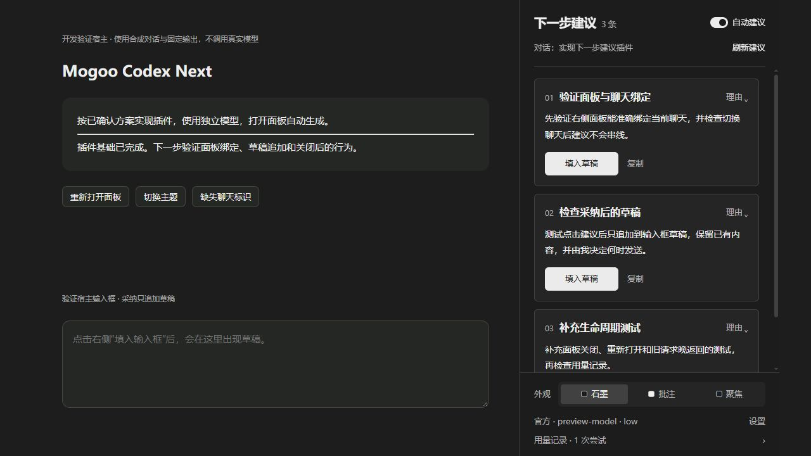
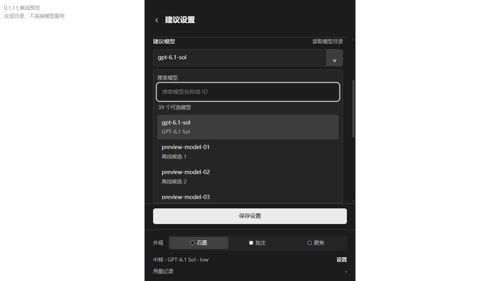

# Mogoo Codex Next

**English** | [简体中文](README.zh-CN.md)

---



*Offline development preview with sample conversation data. The panel currently uses Chinese labels.*

Mogoo Codex Next brings next-step suggestions into the right-hand panel of your current Codex chat. It reads the conversation context, proposes relevant follow-ups, and lets you append a suggestion to your draft for editing and sending.

The plugin uses its own model settings. Open the panel to generate suggestions; close it to pause new requests. You decide what gets sent.

## Features

- **Suggestions for the current chat:** up to three follow-ups based on your goal and the latest completed reply, with expandable reasons.
- **Draft insertion:** append a suggestion without replacing your existing draft. Send it yourself, or copy the suggestion instead.
- **Independent model settings:** choose the provider, model, reasoning effort, and service tier separately from the chat's model.
- **Official or relay connection:** reuse your Codex CLI login, or enter a Responses API endpoint and API key in the panel. Includes an AI Code With preset and custom endpoints.
- **Searchable model picker:** browse the full returned catalog, search names or IDs, use the keyboard, or enter an ID manually. Changes apply after saving.
- **Automatic and manual generation:** generate while the panel is open, refresh on demand, and reuse valid results for an unchanged conversation state.
- **Three appearances:** Graphite, Annotation, and Focus, shared across suggestions, settings, and usage views.
- **Usage records:** view the latest 20 generation attempts in this chat, including reported tokens and fixed error categories.

## Installation

Requires **Python 3.10+** on the `PATH` inherited by Codex, a working **Codex CLI with plugin commands**, and a **Codex desktop app with MCP Apps and chat-panel support**. Official-provider mode also requires a signed-in CLI. Development and native validation have focused on Windows; saving API keys directly currently requires Windows account encryption (DPAPI).

### Copy this prompt and send it to Codex

```text
Install the complete Mogoo Codex Next plugin from the GitHub repository MogooStudio/mogoo-codex-next, using its mogoo-next marketplace and the official Codex plugin CLI. Check Python 3.10+ and Codex CLI availability first. Explain any plugin refresh or restart needed before opening the current chat's Next Steps panel, and any optional Hook trust steps. Let me choose the model in panel settings, keep API keys out of chat, and do not send any draft messages.
```

### Command-line installation

```sh
codex plugin marketplace add MogooStudio/mogoo-codex-next --ref main
codex plugin add mogoo-codex-next@mogoo-next
```

This installs the complete plugin: the chat-panel MCP service, Codex skill, and optional Stop hook. Follow Codex's prompt to refresh plugins or reopen the chat. If a restart is needed, finish active work first.

Hooks must be reviewed and trusted through Codex's official interface. Installing or updating does not automatically trust them. The panel can also detect completed replies through read-only polling.

### Updates

```sh
codex plugin marketplace upgrade mogoo-next
codex plugin add mogoo-codex-next@mogoo-next
```

Then follow Codex's refresh instructions and review changed hooks if prompted. Settings and appearance are stored outside the installation directory. Version changes are listed in the [changelog](CHANGELOG.zh.md).

If you previously installed the local development source, remove that installation through the official CLI before switching sources, then run the installation commands above:

```sh
codex plugin remove mogoo-codex-next@mogoo-codex-next-local
```

This avoids loading two copies of the plugin. Your plugin data directory is separate from the installed files.

## Usage

1. Open **下一步建议** (Next Steps) in the current chat's right-hand panel, or ask Codex: `Open the current chat's Mogoo Codex Next panel.`
2. Open **设置** (Settings). No model is selected by default, so no model request starts until you configure one.
3. Choose **Official** to reuse your CLI login, or **Relay / API** to enter a Responses API base URL and API key. Select AI Code With or a custom endpoint as needed.
4. Read the model catalog or type a model ID. Choose reasoning and service-tier values supported by that model and provider, then save.
5. When the current reply has finished, the open panel can generate suggestions automatically. Expand a reason, copy a suggestion, or use **填入草稿** (Insert into draft) to append it to your draft.
6. Edit and send the draft yourself. Use **刷新建议** (Refresh) for new suggestions, disable automatic suggestions to pause them, or close the panel to stop new requests.

An empty result is valid when there is no useful follow-up. Failed requests do not retry in a loop. Returning to the app rechecks the chat state before enabling draft insertion.



*The 0.1.13 model picker in an offline preview. Catalog entries are synthetic and do not imply provider availability.*

For relay keys, a blank field preserves the saved key for the same endpoint; a new value replaces it. Click **清除** (Clear) beside the API Key label and save to remove it; **取消清除** (Cancel clear) cancels the pending removal before saving. Changing the endpoint requires a key for the new address. Enter keys in the panel, never in a chat message or command argument.

## Development

The runtime uses Python's standard library and static HTML/CSS/JavaScript. There is no npm install or frontend build step. Node.js is needed only for frontend tests; use a version supporting `--test-isolation=none`.

```sh
git clone https://github.com/MogooStudio/mogoo-codex-next.git
cd mogoo-codex-next
python scripts/run.py doctor
python scripts/run.py doctor --probe-cli
python scripts/test.py
node --test --test-isolation=none tests/test_panel.mjs
python scripts/dev_preview.py --port 8765
```

`doctor --probe-cli` starts the CLI only to read the model catalog; it does not run inference. Open [the local development preview](http://127.0.0.1:8765) to exercise the panel with synthetic conversation data and fixed outputs. It uses a temporary data directory, reads no real chats, and makes no real model calls.

Build a local ZIP and installable directory with:

```sh
python scripts/package.py --output dist/mogoo-codex-next-local
```

Choose a fresh output path for each build. The portable MCP manifest uses `python` on `PATH`; the legacy `.mcp.json` in a package uses the build machine's absolute Python path, so rebuild it when moving to another computer.

| Path | Purpose |
| --- | --- |
| `.agents/plugins/marketplace.json` | Repository marketplace and plugin entry |
| `.codex-plugin/plugin.json` | Codex plugin metadata and extension declarations |
| `src/mogoo_codex_next/` | MCP server, context, generation, settings, credentials, and storage |
| `ui/` | Panel markup, styles, and host bridge |
| `skills/`, `hooks/` | Codex skill and optional completion notification |
| `scripts/`, `tests/` | Runtime entrypoint, preview, packaging, and offline checks |
| `docs/` | Validation notes and screenshots |

## Notes

- **Calls and cost:** each generation is a separate model request, billed or metered by the chosen account or service. It does not inherit any quota exemption for Codex's built-in composer predictions. Token records are not a bill or remaining-quota estimate; missing usage is not zero.
- **Privacy:** the selected service receives bounded excerpts of the original goal, recent user messages, and final replies. Raw tool output, reasoning traces, and authentication files are excluded. Choose a provider you trust for that conversation.
- **Local data:** configuration, account-encrypted credentials, appearance, leases, suggestions, and usage live under `<CODEX_HOME or ~/.codex>/mogoo-codex-next/`. Override with `MOGOO_CODEX_NEXT_HOME` or `python scripts/run.py --data-dir <path> ...`. Public settings never return the key value.
- **Generation boundaries:** missing host-provided chat identity stops generation. Only the latest completed turn of an idle, unarchived chat is eligible. The suggestion model does not execute tasks, call tools, or resume the original chat.
- **Closing and caching:** closing or hiding stops new requests; an already-started request may still incur usage. Expired leases, new turns, and configuration changes invalidate stale results. An unchanged state reuses valid results.
- **Compatibility:** draft insertion uses the host's `send:false` extension; without it, copying is available. MCP Apps, chat metadata, and draft support depend on the host version. The bridge targets MCP Apps `2026-01-26` and compatible MCP stdio versions, including `2025-11-25`.
- **Validation:** offline tests and synthetic previews do not establish native-host or real-provider acceptance. See the [validation records](docs/验证记录.md) and [0.1.13 validation note](docs/0.1.13-模型选择器修复验收.md). Windows sandbox restrictions on temporary directories may require running offline tests in a normal user terminal.

## License

[MIT](LICENSE) © 2026 MogooStudio. See [THIRD_PARTY.md](THIRD_PARTY.md) for reference implementations and retained notices.
