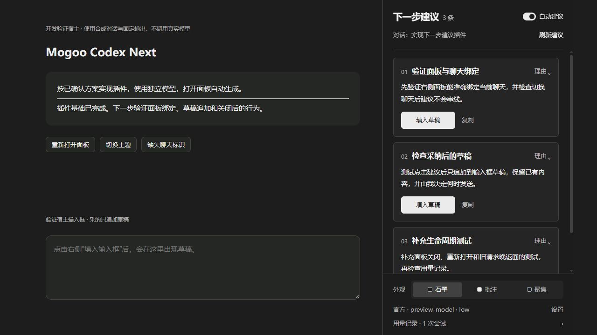
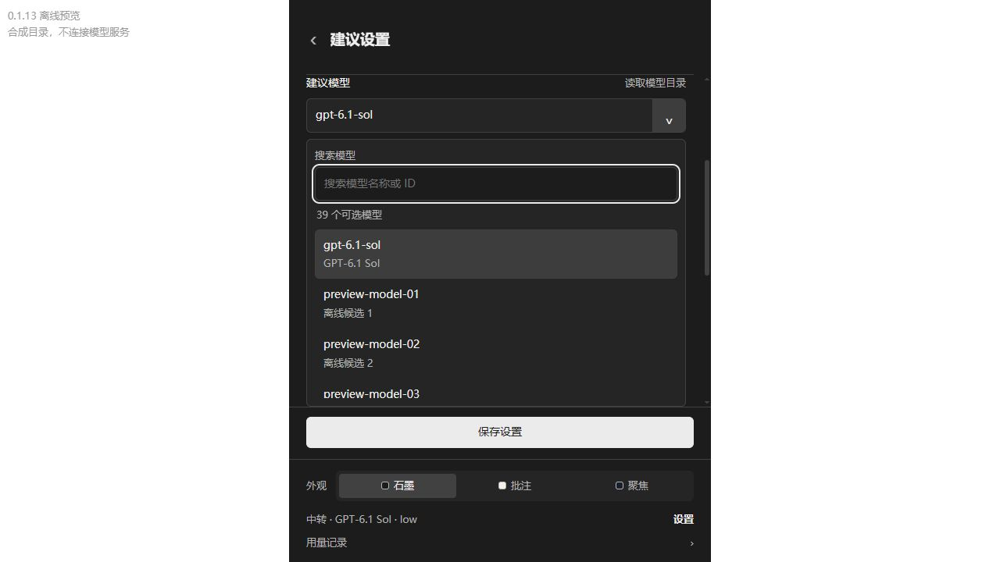

# Mogoo Codex Next

[English](README.md) | **简体中文**

---



*使用合成对话的离线开发预览。面板目前使用中文界面。*

Mogoo Codex Next 在 Codex 当前聊天的右侧面板中生成下一步建议。它根据对话上下文提出相关后续，你可以将建议追加到草稿后编辑发送，也可以点击“直接执行”立即提交该条建议。

插件使用独立的模型设置。打开面板自动生成，关闭面板暂停新请求，发送内容始终由你决定。

## 功能

- **当前聊天的下一步建议**：结合原始目标和最近已完成的回复，生成最多 3 条建议，理由可按需展开。
- **草稿或直接执行**：“填入草稿”追加到输入框供你编辑；“直接执行”将该条完整建议立即提交到当前聊天。仅点击按钮才发送，同一组建议防止重复提交；也可复制建议。
- **独立模型配置**：服务来源、模型、推理强度和服务档位均与当前聊天分开设置。默认建议模型为 `gpt-6.1-terra`，思考程度为低，服务档位为 Fast。
- **中转 API 连接**：直接通过 HTTP 调用所填 Responses API，提供 AI Code With 预设及自定义地址。建议格式只选精简或标准。
- **可搜索的模型目录**：展开完整列表，按名称或 ID 搜索，支持键盘选择及手动输入，保存后才生效。
- **自动与手动生成**：面板打开时自动生成，可手动刷新；对话状态未变时复用有效结果。
- **首条提前展示**：中转流中的首条完整建议经当前聊天复核后先显示，其余继续生成；完整结果校验通过后开放填入草稿。
- **可调文字长度**：默认精简标题（最多 16 字符）和一句话理由（最多 50 字符），可分别切回标准；可编辑指令保留完整信息。
- **指令目标长度**：默认 80 字符，可设置为 0–2000，0 表示不设目标；关键条件优先，复杂指令允许超出，返回后不为满足目标截断指令。
- **三套外观**：石墨、纸笺和微光，建议、设置、用量及更新弹框使用同一外观。选择后立即保存，不改动模型设置或触发建议生成。
- **响应式面板**：保留紧凑侧栏布局，宽屏内容区最多 960px，并根据宿主安全边距避让全屏浮动输入框，让底部控件完整显示。
- **用量记录**：查看本聊天最近 20 次生成尝试、已知 token 用量，并展开 HTTP、聊天复核、首条和全部建议可见的分段耗时；未观测阶段保持未知。

## 安装

需要 **Git**、**Python 3.10+** 和支持 **MCP Apps、聊天侧面板的 Codex 桌面端**，不要求另外安装 Codex CLI。插件优先自动识别桌面端提供的运行组件，用于只读聊天同步；模型生成只使用中转 HTTP API。开发和原生验证主要在 Windows 上进行，面板直接保存 API Key 当前依赖 Windows 账户加密（DPAPI）。

### 复制下面这段话发给 Codex

```text
帮我从 GitHub 仓库 https://github.com/MogooStudio/mogoo-codex-plugin.git 安装完整插件，使用仓库内的 mogoo-codex-plugin 插件市场和 Codex 官方插件入口。先检查 Git、Python 3.10+ 和桌面端内置运行组件是否可用，不要要求我另装 CLI。说明打开当前聊天“下一步建议”面板前需要的刷新或重启步骤。可选 Hook 如需我在界面中审阅并信任，请告诉我怎么操作。让我在面板设置中自行选择模型，不要在聊天中索取 API Key，也不要发送任何草稿。
```

### 命令行安装（可选）

以下 `codex` 可使用桌面端自带运行组件的完整路径，或已有的命令行入口；无需另外安装 npm CLI 包。

```sh
codex plugin marketplace add https://github.com/MogooStudio/mogoo-codex-plugin.git --ref main
codex plugin add mogoo-codex-next@mogoo-codex-plugin
```

安装内容包括聊天面板 MCP 服务、Codex 技能及可选 Stop Hook。随后按 Codex 提示刷新插件。新开聊天或重启 Codex 后生效；重启前先完成正在进行的工作。

安装和更新不会自动信任 Hook，需在 Codex 官方入口审阅并信任。未信任时面板仍可通过只读轮询发现已完成的回复。

可在 **Mogoo Codex Plugin** 市场中选择 **Mogoo Codex Git**，或执行 `codex plugin add mogoo-codex-git@mogoo-codex-plugin` 单独安装。

### 从旧市场迁移

新市场发布后，旧 `mogoo-next` 用户先关闭「下一步建议」面板，再执行一次以下命令。设置、外观、加密 Key 和用量记录保存在插件数据目录中。

```sh
codex plugin remove mogoo-codex-next@mogoo-next
codex plugin marketplace remove mogoo-next
codex plugin marketplace add https://github.com/MogooStudio/mogoo-codex-plugin.git --ref main
codex plugin add mogoo-codex-next@mogoo-codex-plugin
```

### 后续更新

插件默认在面板打开时检查公开仓库标签，自动检查最多每 6 小时一次；失败后至少等待 1 小时，不弹错误，也不自动循环重试。只读取标签列表，不上传聊天、设置或任何其他数据。可在设置中关闭“检查更新”，或点击“立即检查”。立即检查会绕过六小时成功缓存，自动检查关闭时也可手动联网；失败后的一小时冷却仍然有效。同一时间只进行一次检查。若缓存标签低于已安装或市场快照版本，“远端”显示“未知”，可立即检查获取新值。

Codex 通常会在后台自动升级 Git 市场及已安装插件的缓存，不依赖重启 Codex；本插件的“检查更新”开关只控制读取远端标签，不会关闭 Codex 自身的更新机制。每次打开面板都会重新读取本地状态，设置页分别显示运行中、已安装、市场快照及远端版本。

如果新版已安装、当前进程仍运行旧版，底栏显示“等待生效”，不能忽略：“已更新到 X，当前仍在运行 Y。新开聊天或重启 Codex 后生效。”当前尚未确认新进程由新开聊天还是重启 Codex 触发，因此保留两种操作的提示。

远端有新版而本地尚未安装时，公开 `mogoo-codex-plugin` 市场来源会提示“发现 X。Codex 通常会在后台自动更新；也可以点击立即更新。”。也可使用次要按钮“立即更新”，先审阅并确认命令；市场快照已就绪时跳过市场升级，已经安装时不再执行命令。开发目录及其他来源只提供复制命令或填入草稿（由你自行发送）。只有尚未安装的远端版本可以忽略。Hook 变化时需重新审阅并信任。

Git 来源的市场安装和升级需要系统中可用的 `git`；检查更新本身无需 Git。更新失败时不自动重试，使用以下命令：

```sh
codex plugin marketplace upgrade mogoo-codex-plugin
codex plugin add mogoo-codex-next@mogoo-codex-plugin
```

随后按 Codex 提示刷新，并在提示时重新审阅变化的 Hook。插件设置与外观保存在安装目录之外，版本变化见[更新记录](CHANGELOG.zh.md)。

如果 `mogoo-codex-plugin` 仍指向旧来源，确认切换后先移除该市场，再添加上方公开地址并安装插件。设置、加密 Key 和用量记录位于 `~/.codex/mogoo-codex-next/`，不受市场切换影响。不要在更新过程中手动删除缓存；遇到文件占用时，关闭使用插件的聊天后在外部终端重试两条更新命令。

如果之前安装过本地开发来源，切换前先通过官方 CLI 卸载旧来源，再执行上方安装命令：

```sh
codex plugin remove mogoo-codex-next@mogoo-codex-next-local
```

这样可避免同时加载两份插件。插件数据目录与安装文件分开保存。

## 使用

1. 在当前聊天右侧打开 **下一步建议**，也可让 Codex：`打开当前聊天的下一步建议面板。`
2. 点击 **设置**。默认模型为 `gpt-6.1-terra / low / Fast`，填写 API 地址和 Key 前不会发起模型请求。
3. 填写中转 Responses API 基础地址和 API Key，可选 AI Code With 或自定义地址，生成时直接使用 HTTP。
4. 设置页按 **建议格式**、**模型参数** 和 **API 连接** 分区。选择 **精简** 或 **标准**，通过“生成模型”下拉框选择模型，或选“手动输入模型 ID”填写；配置 API 连接后点击 **保存设置**。精简使用短标题、一句话理由和约 80 字符指令；两种格式都保留关键条件，复杂任务可超出，不截断指令。
5. 当前回复完成后，打开的面板可自动生成建议。展开理由、复制内容，或点击 **填入草稿** 追加到输入框。
6. 自行编辑并发送。点击 **刷新建议** 可重新生成，关闭自动建议可暂停自动生成，关闭面板则停止新请求。

没有合理后续时，空结果是正常情况；失败不会循环重试。切回应用时会先确认当前聊天状态，再允许填入草稿。

设置页底部的“一键恢复默认配置”会立即保存默认模型、思考程度、服务档位、建议格式和更新设置；保留 API 地址、已保存的 Key、外观、各聊天的自动建议开关及用量记录。表单内尚未保存的 API 输入会继续保留，需另行点击“保存设置”。



*0.1.13 模型选择器的离线预览。目录条目为合成数据，不代表服务商实际可用模型。*

中转 Key 保存后，输入框留空表示沿用相同地址的已保存 Key，填写新值可替换。点击 API Key 标题右侧的“清除”并保存可删除；保存前可点击“取消清除”。更换 API 地址时需填写新地址对应的 Key。真实 Key 只在面板填写，不要放入聊天或命令参数。

## 开发

运行时使用 Python 标准库和静态 HTML/CSS/JavaScript。MCP 与 Hook 共用随包启动入口：macOS/Linux 依次检查 `python3`、`python`；Windows 依次检查 `py -3`、`python`、`python3`，只使用 Python 3.10+。Windows x64 启动器自带运行时，用户无需安装 Go。无需 npm 安装或前端构建。Node.js 只用于前端测试，需支持 `--test-isolation=none`。

```sh
git clone https://github.com/MogooStudio/mogoo-codex-next.git
cd mogoo-codex-next
python scripts/run.py doctor
python scripts/run.py doctor --probe-cli
```

`doctor --probe-cli` 只启动 CLI 读取模型目录，不发起推理。完整测试与开发预览位于私有开发仓库，不随公开发布包分发。

生成本机 ZIP 和可安装目录：

```sh
python scripts/package.py --output dist/mogoo-codex-next-local
```

每次打包请使用尚不存在的输出路径。两种 MCP 声明均使用插件启动入口，不再写入打包机器的 Python 路径；ZIP 保留 POSIX 入口的执行权限。重建 `scripts/launch.exe` 需本机已有 Go 1.26.6，运行 `python scripts/build_launcher.py`（禁用依赖下载）。发布包只含运行代码、构建入口、对外文档和 README 引用的图片；测试与验收记录留在私有开发仓库。

| 路径 | 用途 |
| --- | --- |
| `.agents/plugins/marketplace.json` | 插件市场和两个可独立安装的条目 |
| `.codex-plugin/plugin.json` | Codex 插件元数据与扩展声明 |
| `src/mogoo_codex_next/` | MCP 服务、上下文、生成、设置、凭据和存储 |
| `ui/` | 面板页面、样式及宿主桥接 |
| `skills/`、`hooks/` | Codex 技能及可选回复完成通知 |
| `scripts/` | 运行入口和打包、构建脚本 |
| `docs/images/` | README 引用的预览图片 |

Next 和 Git 各自使用独立的仓库和 `vX.Y.Z` 标签，统一列在 `mogoo-codex-plugin` 市场。Git 的源码与预构建包由 [GitHub 项目仓库](https://github.com/MogooStudio/mogoo-codex-git)提供；市场从其 `main` 分支读取 `plugins/mogoo-codex-git/` 下的插件包。

## 说明

- **调用与费用**：每次生成是一次独立模型请求，按所选账号或服务商规则计量，不沿用 Codex 官方 Composer predictions 的免额度规则。token 记录不等同账单或剩余额度，未知用量不表示零消耗。
- **对话隐私**：所选服务会收到有限的原始目标、最近用户消息和最终回复摘录，不包含工具原始输出、推理过程或认证文件。请为该聊天选择你认可的服务商。
- **本地数据**：配置、账户加密凭据、外观、租约、建议与用量位于 `<CODEX_HOME 或 ~/.codex>/mogoo-codex-next/`；可用 `MOGOO_CODEX_NEXT_HOME` 或 `python scripts/run.py --data-dir <路径> ...` 覆盖。公开设置接口不返回实际 Key。
- **生成范围**：缺少宿主提供的聊天标识时停止生成，仅处理非活动、非归档聊天的最新已完成轮次。建议模型不执行建议、不调用工具、不恢复原聊天任务。
- **关闭与缓存**：关闭或隐藏后不启动新请求，已发出的请求仍可能计量。租约过期、新轮次或配置变化会使旧结果失效；同一状态复用有效结果。
- **兼容性**：填入草稿使用宿主的 `send:false` 扩展，直接执行使用 MCP Apps `ui/message` 发送后续消息；按宿主能力显示按钮，不支持时提供复制。MCP Apps、聊天标识及草稿能力取决于宿主版本；桥接使用 MCP Apps `2026-01-26` 及包含 `2025-11-25` 在内的兼容 MCP stdio 版本。
- **验收范围**：离线测试和合成预览不能替代原生宿主、真实服务调用验收。版本变化见[更新记录](CHANGELOG.zh.md)。Windows 沙箱若限制临时目录访问，应在正常用户终端运行离线测试。

## License

[MIT](LICENSE) © 2026 MogooStudio。第三方参考与保留声明见 [THIRD_PARTY.md](THIRD_PARTY.md)。

## 已知限制

Codex 自动更新可能删除旧版本缓存目录。旧会话中绑定该目录的 Stop Hook 因此可能执行失败，这是宿主的缓存生命周期限制；插件不会绕过 Hook 信任机制。面板的只读轮询仍可发现已完成回复。MCP 在启动时预加载模块和界面，避免服务过程继续依赖旧安装目录。


### 更新响应兼容约定

更新响应字段只增不删，旧界面可能与新后端同时存在。保留 current、available、latest、checked_at、status、checking、dismissed、can_install、commands、changelog_url、operation 以及 running、installed、snapshot、state；available 在未忽略的自动/手动更新和等待生效时为 true，等待生效时 can_install 始终为 false。latest 保留远端缓存原值，latest_stale 标记其落后，target 表示结合本地快照得到的更新目标。

修改响应时必须通过历史界面兼容矩阵 `tests/test_update.py`。字段契约保存在 `tests/fixtures/update_ui_contracts.json`，来自公开标签 v0.1.42–v0.1.45 的 ui/panel.js；可用 `python tests/refresh_update_contracts.py --repo <公开仓库副本>` 从本地标签重新提取。

界面代码只在打开面板时加载一次，升级后不会自动替换已打开的页面。0.1.46 及以后的界面会在后端版本不同时提示“插件已更新到 X，请重新打开此面板以使用新界面。”；更旧界面无法补上该检测，需要用户重新打开面板，建议刷新仍可正常使用。新开聊天是否必定拉起新版 MCP 尚未验证，不作保证。
